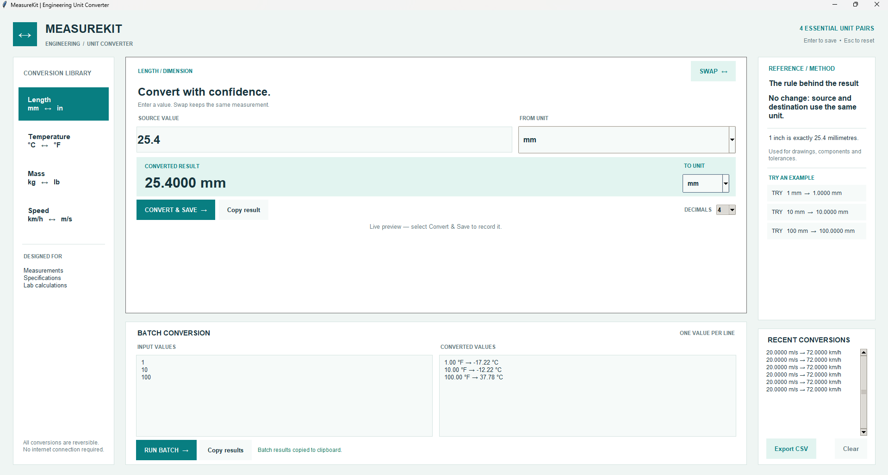

# MeasureKit — Engineering Unit Converter

**MeasureKit** is a Python desktop engineering unit converter with a visual Tkinter interface. It covers the **four unit pairs specified in the CTE123 ND1 Python mini-project brief**: millimetres/inches, Celsius/Fahrenheit, kilograms/pounds, and kilometres per hour/metres per second.



## What it does

Choose **Length**, **Temperature**, **Mass**, or **Speed** in the navigation column. Enter a number to see a **live conversion preview** in the selected units. **Convert & Save** records the calculation; **Swap** reverses the direction *while preserving the measured quantity*. The **Try an example** buttons load valid inputs instantly. A separate **Batch conversion** panel processes up to 500 lines, reports invalid lines, and allows users to copy the results. Recent conversions can be reviewed or exported to a CSV file.

| Category | Forward | Reverse |
| --- | --- | --- |
| Length | `in = mm ÷ 25.4` | `mm = in × 25.4` |
| Temperature | `°F = (°C × 9/5) + 32` | `°C = (°F − 32) × 5/9` |
| Mass | `lb = kg ÷ 0.45359237` | `kg = lb × 0.45359237` |
| Speed | `m/s = km/h ÷ 3.6` | `km/h = m/s × 3.6` |

The program uses exact, defined conversion factors where applicable, and only rounds values **for display**, not while calculating. It accepts negative temperatures; length, mass, and speed are limited to non-negative measurements in this introductory tool.

## How to run

Install Python 3 with Tkinter support, open this folder in VS Code or a terminal, and run:

```bash
python unit_converter.py
```

On Windows, `py unit_converter.py` is another option. **No third-party Python packages, API keys, network connection, or hosting are required.** Tkinter may need separate installation on some Linux systems; typical desktop Python installations on Windows include it.

## Example

```text
Category: Length
From: mm       To: in
Input: 25.4
Result: 1.0000 in

Click Swap:
From: in       To: mm
Input: 1
Result: 25.4000 mm
```

For a batch, select **Speed**, choose **km/h → m/s**, type `36`, `72`, and `108` on separate lines, and press **Run Batch**. The outputs are `10`, `20`, and `30` m/s, displayed at the selected precision.

## My own twist: practical measurement workflow

The assignment requires a basic conversion menu. MeasureKit extends it with:

- **Live preview** while entering values, with clear units next to input and result.
- **Measurement-preserving Swap:** `25.4 mm → 1 in` becomes `1 in → 25.4 mm` rather than accidentally converting `25.4 inches`.
- **Click-to-try reference examples**, selected formulas, and category-specific engineering notes.
- **Selectable precision** (2, 4, 6, or 8 decimals) without reducing computation accuracy.
- **Batch conversion** for up to 500 lines with individual error feedback and copyable results.
- **Session history**, scrolling list, and CSV export for keeping measurement records.
- **Validation** that prevents invalid text, non-finite inputs, and unsupported negative non-temperature measurements from crashing the application.

## Intentional UI and UX decisions

- **Left — navigation:** the four measurement categories stay visible, including both unit symbols; no hidden menus or memorized codes are necessary.
- **Centre — primary task:** input, source unit, converted result, and destination unit follow the order in which a person performs a conversion. The result is large and placed on a pale background for immediate recognition. Swap is beside the source/destination controls.
- **Right — verification:** the active formula, exact conversion note, and clickable sample values stay available for checking calculations or getting started.
- **Below — batch work:** converting many measurements is a secondary task, available without cluttering the main input flow.
- **Palette:** clean mineral-white `#EFF5F3` and white `#FFFFFF` resemble a technical worksheet; deep navy `#17343D` makes values readable; teal `#087E81` identifies navigation and primary actions; pale teal `#E2F4F0` marks the output region; muted red `#B34848` communicates input errors. Color is supported by text labels, so meaning never depends on color alone.
- **No ornamental 3D or external UI dependency:** the interface prioritizes readable measurements, correct units, and reliable offline use.

## Assignment requirements covered

| Lecturer requirement | Implementation |
| --- | --- |
| Choose an approved Python project | Engineering Unit Converter |
| Four required unit pairs | `CATEGORIES` and `convert_value()` |
| At least one function | `convert_value()`, `parse_measurement()`, `convert_batch()` and other methods |
| At least one loop | Line-by-line batch processing; navigation and history iteration |
| At least one `if/elif/else` | Category-specific formulas in `convert_value()` |
| Numeric conversion with `int()` or `float()` | `float()` in `parse_measurement()`; `int()` for decimal precision |
| Handle invalid values | Invalid input messages and per-line batch errors |
| Helpful code comments | File header and explanatory comments for formulas and key UI logic |
| An original extra feature | Live preview, measurement-preserving Swap, batch tools, examples, and history |
| GitHub and LinkedIn | Publish the code repository and a separately written first-person LinkedIn post |

## Automated tests

```bash
python -m unittest discover -s tests -v
```

The tests verify both directions of all four conversions, known reference values, negative temperatures, round trips, input validation, batch error handling, and precision formatting. The GUI was also manually exercised for navigation, Swap, examples, batch processing, copy, and history.

## Project structure

```text
engineering-unit-converter/
├── unit_converter.py
├── README.md
├── .gitignore
├── assets/
│   └── measurekitproject.screenshot.png
└── tests/
    ├── test_conversions.py
    └── test_user_workflows.py
```

## Skills demonstrated

This project demonstrates Python functions, loops, conditional statements, dictionaries, lists, float conversion, defensive error handling, Tkinter interface design, event-driven programming, automated tests, and CSV file handling. It also highlights the importance of exposing engineering units and measurement direction clearly, not merely calculating a number.

## Authorship and submission

**Student:** Egbonodje Okeoghene Elizabeth  
**Program:** ND1 Mechatronics Engineering, Yaba College of Technology (YABATECH).  
**GitHub repository name:** `egbonodje-engineering-unit-converter`

This version was developed with AI-assisted implementation and review. As required by the assignment, the submitting student must understand, verify, and be able to explain the code and comply with the lecturer's own-work expectations. No matriculation number or personal secrets should appear in the public repository.

For submission, publish this repository under `egbonodje-engineering-unit-converter`, then write a **100–200-word original first-person LinkedIn post** containing the published repository URL and a genuine tag of **Sumayyah Taiwo**, and complete the submission form. The brief states a deadline of **Wednesday, 11 November 2026, at 11:59 p.m.**
